# Colorbeam

A Beamer theme for university lectures and lab sessions. It started as the slide style for my own embedded systems course, where I needed something that handles circuit diagrams, code listings and a lot of step-by-step instructions, but more importantly, didn't look from the _90s_.

[](https://github.com/Eskander/colorbeam/actions/workflows/ci.yaml) 

---

The idea is simple: each part of a lecture gets its own color, and everything on the slides (title bar, bullets, boxes, code frames) follows it.


The theme is split in two layers. The core is subject-neutral and is all you need for most lectures. On top of it there are optional libraries for specific fields, currently `programming` and `electronics`. You load only the ones you use, so a history or chemistry lecture does not need CircuiTikZ installed.

## What you get

### Core

**Sections with a color of their own.** `\partslide{2}{sky}{Tables and structure}{tables, pipelines and tiles}` draws a full-bleed divider and switches every following slide to that color until the next one. There are ten colors in the palette, picked to stay readable when projected in a bright room (so nothing too neon).

| Part divider | One divider per section color |
| --- | --- |
|  | 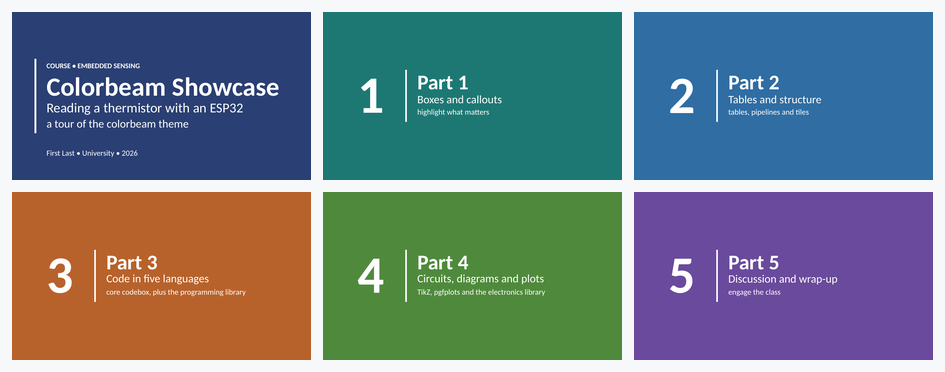 |

| The palette | Re-branding with `\setmaincolor` |
| --- | --- |
|  | 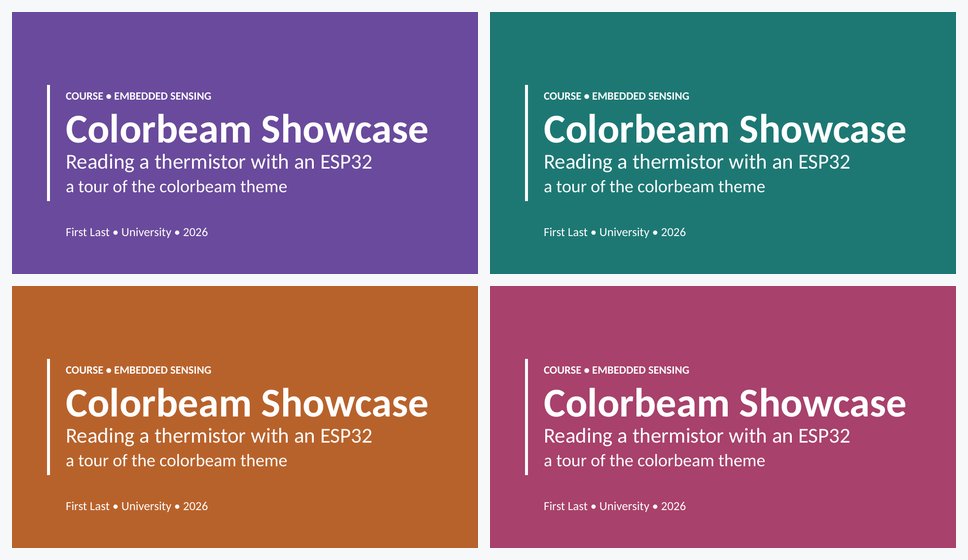 |

`\setmaincolor{plum}` re-colors the title slide, the introduction and everything after `\resetpart` with one line.

**Callout boxes.** `card`, `tip`, `infobox`, `warnbox`, `okbox`, `darkbox`, and `colorcard` if you want any palette color.

| Callout boxes | Any color, any box |
| --- | --- |
|  | 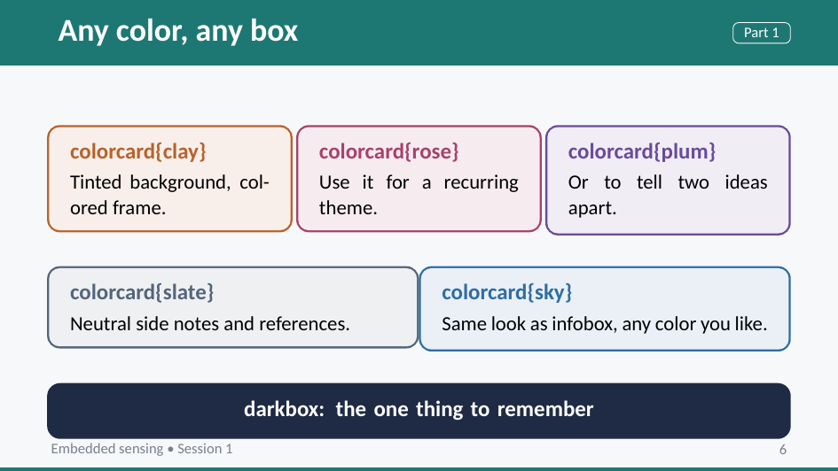 |

**Steps, rows and pills.** Numbered steps (`\step`), small colored labels (`\pill`), one-line framed rows (`\numrow`, `\helprow`), and a big faded question mark for discussion slides (`\questionmark`).

| Bullets, steps and pills | Numbered and troubleshooting rows |
| --- | --- |
| 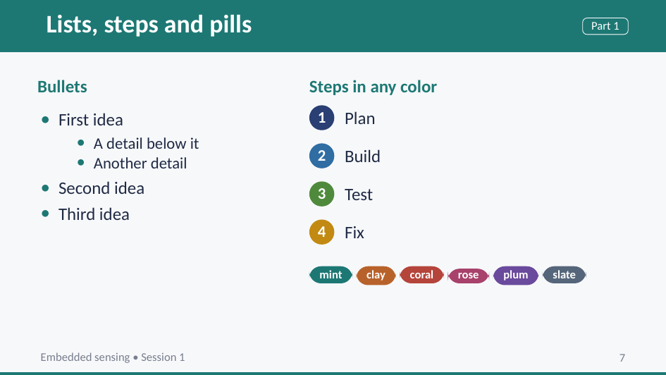 | 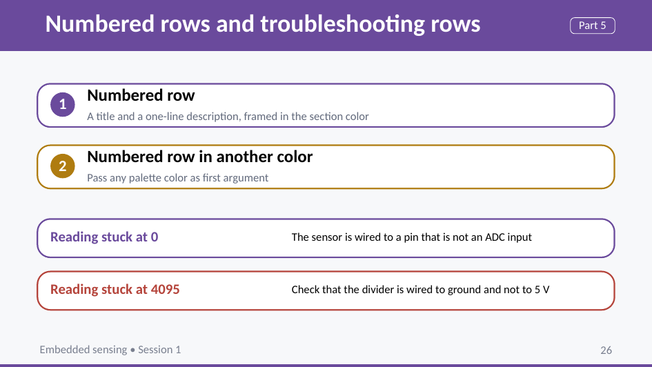 |

| Outline with colored steps | Discussion slide |
| --- | --- |
| 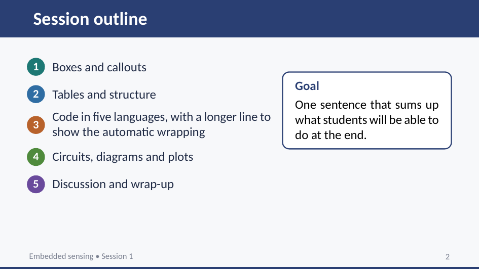 |  |

**Tables and layout.** Tables follow the section color, and a few TikZ styles (`flowbox`, `tile`, `stagebox`, `ar`) cover boxes-and-arrows diagrams.

| Table | Summary slide with a `darkbox` |
| --- | --- |
| 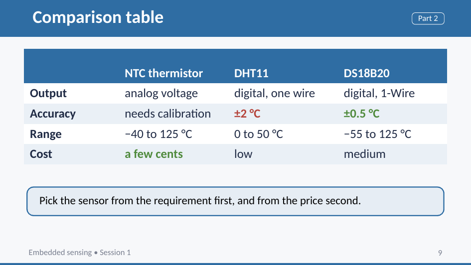 | 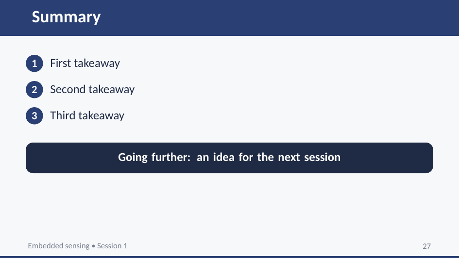 |

| `stagebox` pipeline | `tile` grid |
| --- | --- |
| 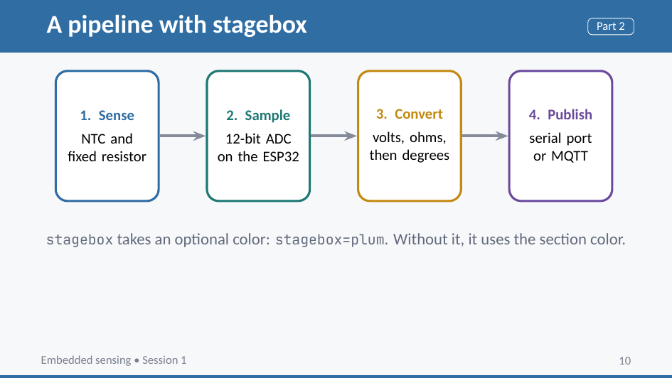 | 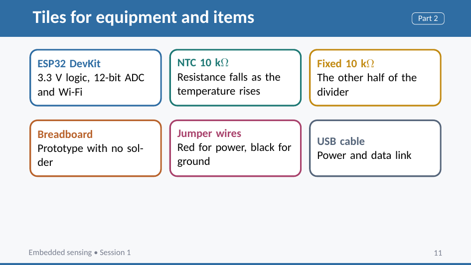 |

**Formulas and plots.** TikZ and pgfplots are loaded and set up with the theme colors.

| `flowbox` | Line plot |
| --- | --- |
| 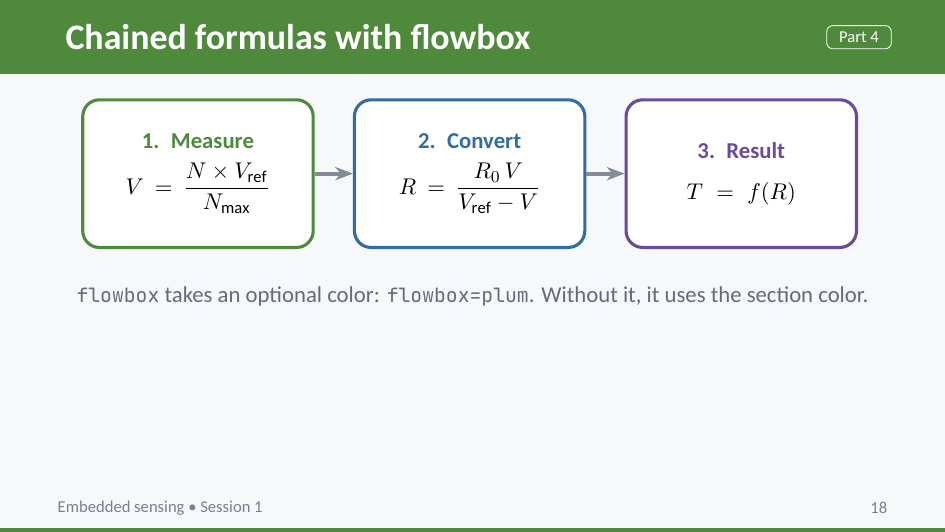 |  |

| Bar chart in palette colors | Generic `codebox` |
| --- | --- |
| 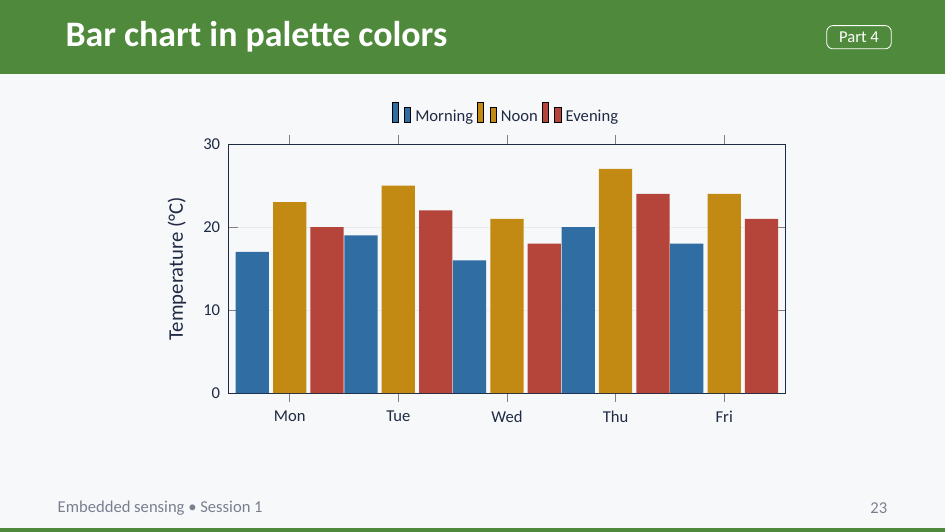 | 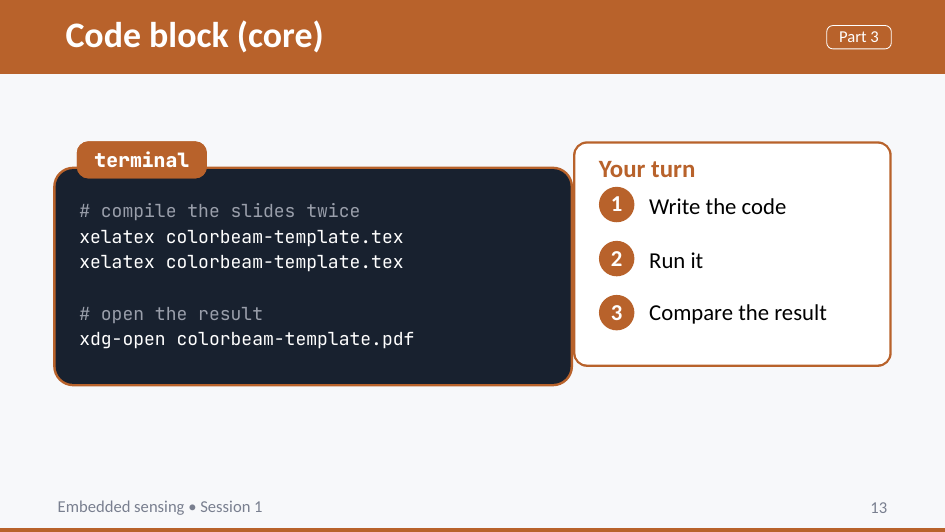 |

`codebox` is a generic dark code block for any language known to `listings`.

### Library: programming

Load it with `\usecolorbeamlibrary{programming}`. It adds highlighting styles tuned for the palette and a code block environment for each language:

| Environment | Language |
| --- | --- |
| `pycode` | Python |
| `jscode` | JavaScript |
| `ccode` | C |
| `cppcode` | C++ |
| `ino` | Arduino (C++ with the Arduino API highlighted) |

Each one takes the same options as `codebox`, for example `\begin{pycode}[title={main.py}]`. Accented letters in comments and strings work, which matters if you teach in French or Spanish. Frames that contain code must be marked `[fragile]`.

| Python and JavaScript | C and C++ |
| --- | --- |
|  | 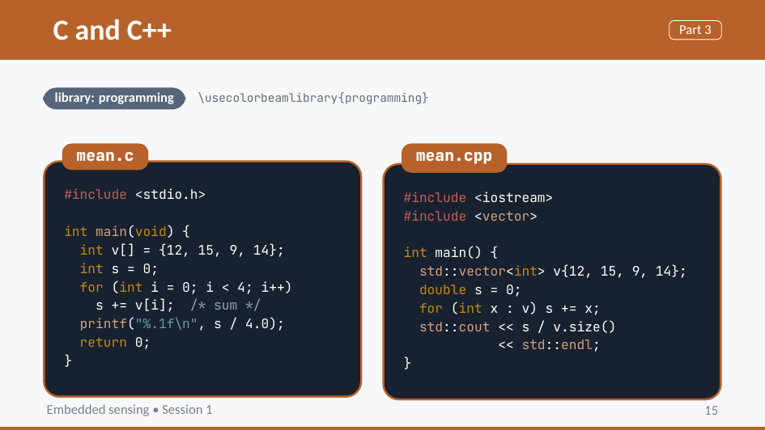 |

| Arduino |
| --- |
| 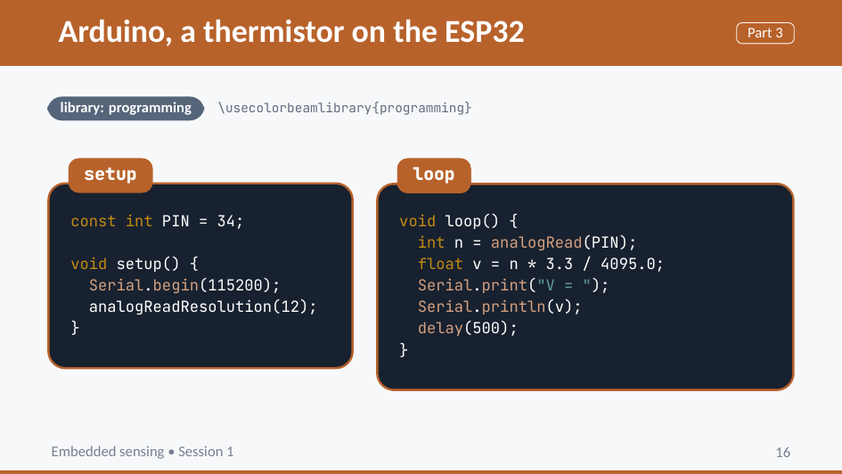 |

### Library: electronics

Load it with `\usecolorbeamlibrary{electronics}`. It loads CircuiTikZ in its European style, defines `\ohm`, and adds TikZ styles for wiring diagrams: `wire`, `board` (a dark module such as an ESP32 or an Arduino), `pinc` (a pin) and `pinl` (a pin label). The styles also work in plain TikZ pictures.

| Schematic | Wiring diagram |
| --- | --- |
|  | 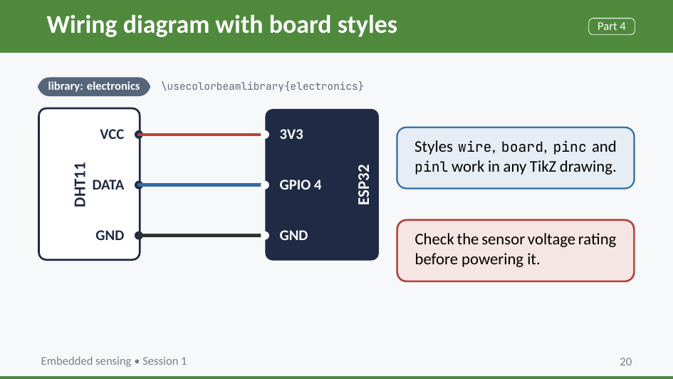 |

| RC circuit |
| --- |
| 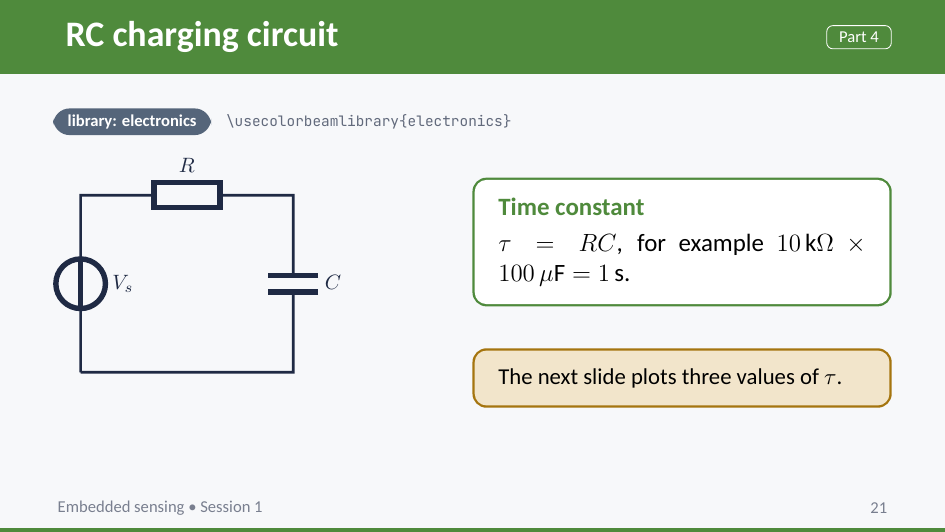 |

`colorbeam-template.tex` is a short lecture in five parts, one palette color each, and it uses everything above, so it doubles as the reference. It loads both libraries, so delete the ones you do not need.

## Requirements

* XeLaTeX or LuaLaTeX. The theme needs `fontspec`, so plain pdfLaTeX will not work.
* The default fonts are Carlito (sans) and JetBrains Mono (monospace). Both are free and open source, and most Linux distributions package them (see below). You can use others.
* Core packages: `fontspec`, `etoolbox`, `tikz`, `pgfplots`, `tcolorbox`, `listings`, `colortbl`, `array`.
* The electronics library also needs `circuitikz`.

All of the TeX packages are part of a full TeX Live or MiKTeX install. The fonts are not, so install them separately (on Debian and Ubuntu: `fonts-jetbrains-mono` and `fonts-crosextra-carlito`).

## Installing

### From a package (Linux)

Each [release](https://github.com/Eskander/colorbeam/releases) ships a `.deb`, an `.rpm` and a `.pkg.tar.zst`. They install the theme into `/usr/share/texmf/tex/latex/colorbeam/` and pull in the required TeX packages and fonts.

```bash
sudo apt install ./colorbeam_*_all.deb          # Debian, Ubuntu
sudo dnf install ./colorbeam-*.noarch.rpm       # Fedora
sudo pacman -U colorbeam-*.pkg.tar.zst          # Arch Linux
```

The packaging recipes live in [`packaging/`](packaging/).

### Manually

Put `beamerthemecolorbeam.sty` and the library files you want (`colorbeamlib-programming.sty`, `colorbeamlib-electronics.sty`) next to your `.tex` file. To make them available everywhere, copy them into your local texmf tree, for example `~/texmf/tex/latex/colorbeam/` on Linux and macOS, then run `texhash` if your distribution needs it.

## Contributing

Issues and pull requests are welcome. If you report a layout problem, a screenshot and the smallest `.tex` file that shows it will save us both time.
