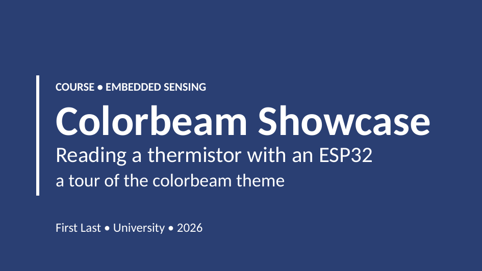
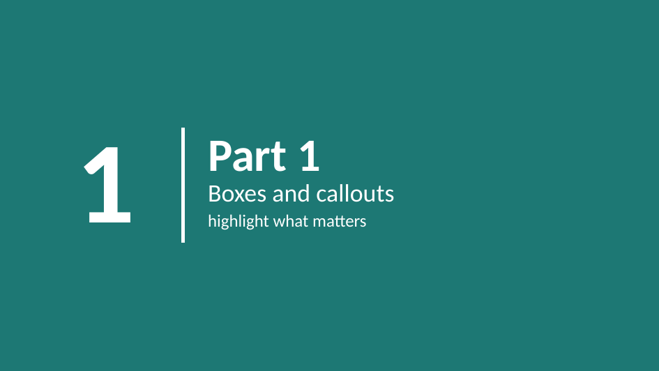
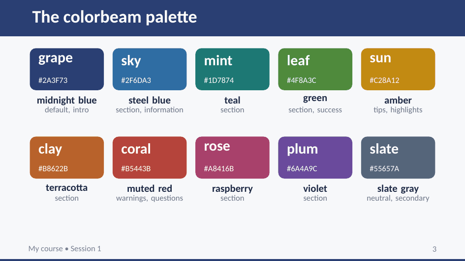
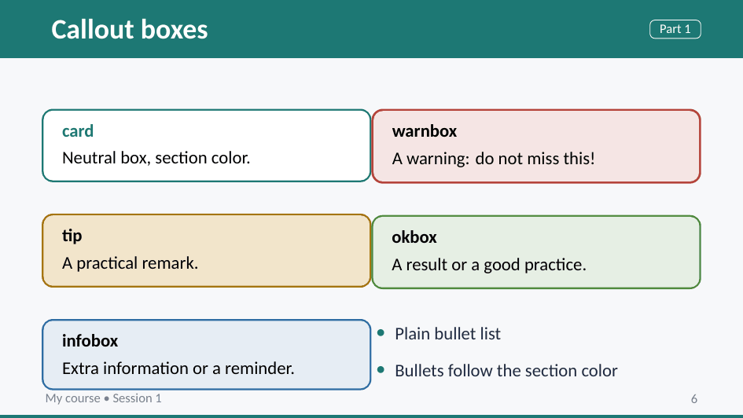
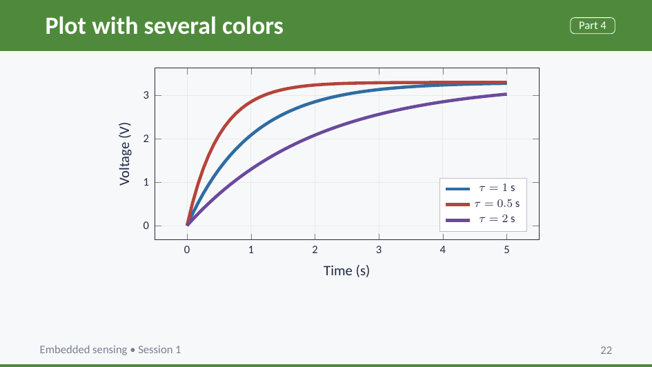
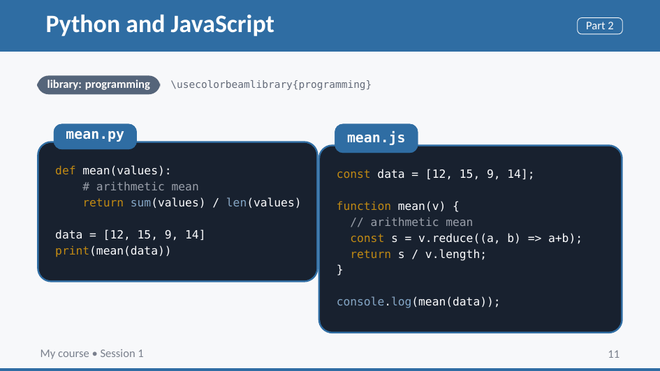
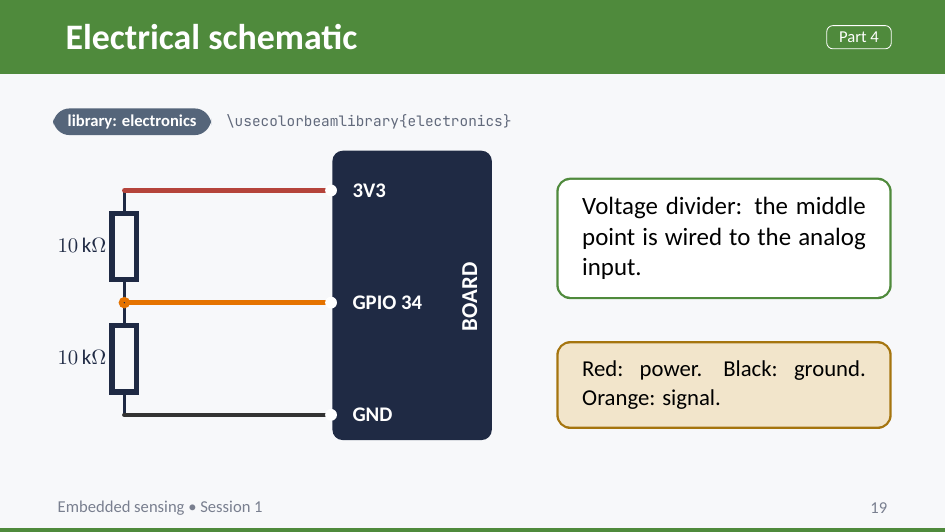

# Colorbeam

A Beamer theme for university lectures and lab sessions. It started as the slide style for my own embedded systems course, where I needed something that handles circuit diagrams, code listings and a lot of step-by-step instructions, but more importantly, didn't look from the _90s_.

 

---

The idea is simple: each part of a lecture gets its own color, and everything on the slides (title bar, bullets, boxes, code frames) follows it.

The theme is split in two layers. The core is subject-neutral and is all you need for most lectures. On top of it there are optional libraries for specific fields, currently `programming` and `electronics`. You load only the ones you use, so a history or chemistry lecture does not need CircuiTikZ installed.

## What you get

### Core

**Sections with a color of their own.** `\partslide{2}{sky}{Tables and code}{structured content}` draws a full-bleed divider and switches every following slide to that color until the next one. There are ten colors in the palette, picked to stay readable when projected in a bright room (so nothing too neon).

**Callout boxes.** `card`, `tip`, `infobox`, `warnbox`, `okbox`, `darkbox`, and `colorcard` if you want any palette color.

There are also numbered steps (`\step`), small colored labels (`\pill`), one-line framed rows (`\numrow`, `\helprow`), a big faded question mark for discussion slides (`\questionmark`), a generic dark `codebox` for any language known to `listings`, and a few TikZ styles (`flowbox`, `tile`, `stagebox`, `ar`) for boxes-and-arrows diagrams. TikZ and pgfplots are loaded and set up with the theme colors.

### Library: programming

Load it with `\usecolorbeamlibrary{programming}`. It adds highlighting styles tuned for the palette and a code block environment for each language:

| Environment | Language |
| --- | --- |
| `pycode` | Python |
| `jscode` | JavaScript |
| `ccode` | C |
| `cppcode` | C++ |
| `ino` | Arduino (C++ with the Arduino API highlighted) |

Each one takes the same options as `codebox`, for example `\begin{pycode}[title={main.py}]`. Accented letters in comments and strings work, which matters if you teach in French or Spanish. Frames that contain code must be marked `[fragile]`.

### Library: electronics

Load it with `\usecolorbeamlibrary{electronics}`. It loads CircuiTikZ in its European style, defines `\ohm`, and adds TikZ styles for wiring diagrams: `wire`, `board` (a dark module such as an ESP32 or an Arduino), `pinc` (a pin) and `pinl` (a pin label).

`colorbeam-template.tex` uses everything above, so it doubles as the reference. It loads both libraries, so delete the ones you do not need.

## Requirements

* XeLaTeX or LuaLaTeX. The theme needs `fontspec`, so plain pdfLaTeX will not work.
* The default fonts are Carlito (sans) and DejaVu Sans Mono. Both are free and ship with most TeX distributions. You can use others.
* Core packages: `fontspec`, `etoolbox`, `tikz`, `pgfplots`, `tcolorbox`, `listings`, `colortbl`, `array`.
* The electronics library also needs `circuitikz`.

All of these are part of a full TeX Live or MiKTeX install.

## Installing

Put `beamerthemecolorbeam.sty` and the library files you want (`colorbeamlib-programming.sty`, `colorbeamlib-electronics.sty`) next to your `.tex` file. To make them available everywhere, copy them into your local texmf tree, for example `~/texmf/tex/latex/colorbeam/` on Linux and macOS, then run `texhash` if your distribution needs it.

## Contributing

Issues and pull requests are welcome. If you report a layout problem, a screenshot and the smallest `.tex` file that shows it will save us both time.
